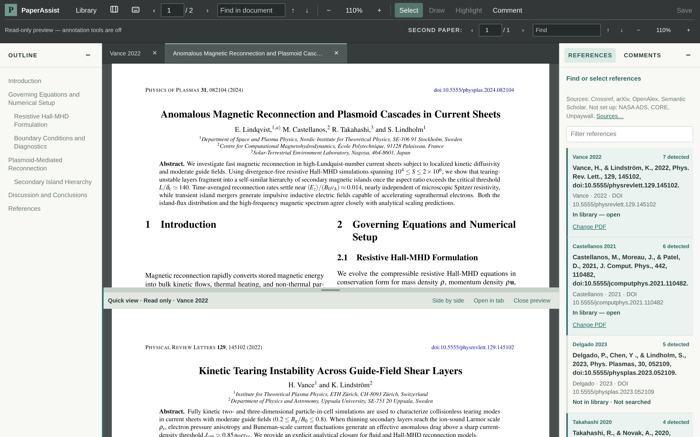
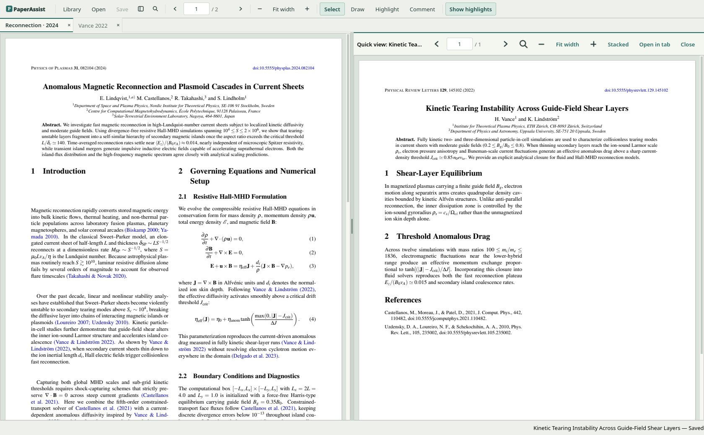
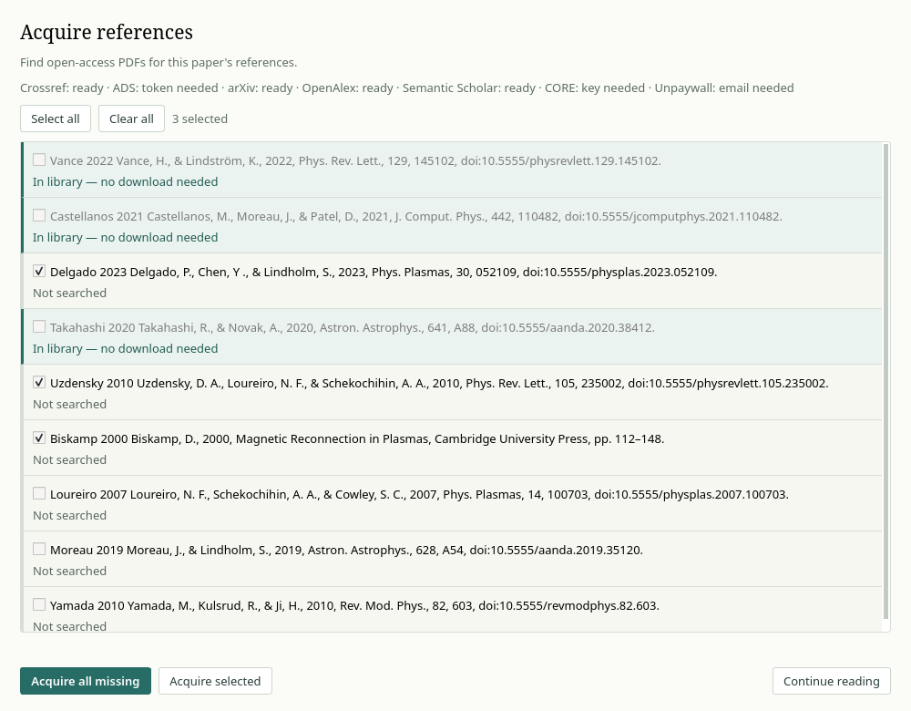
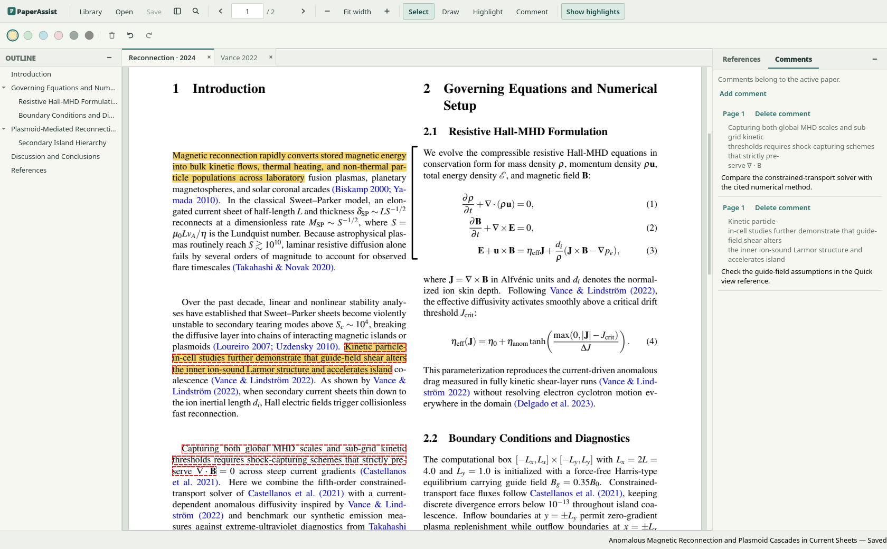
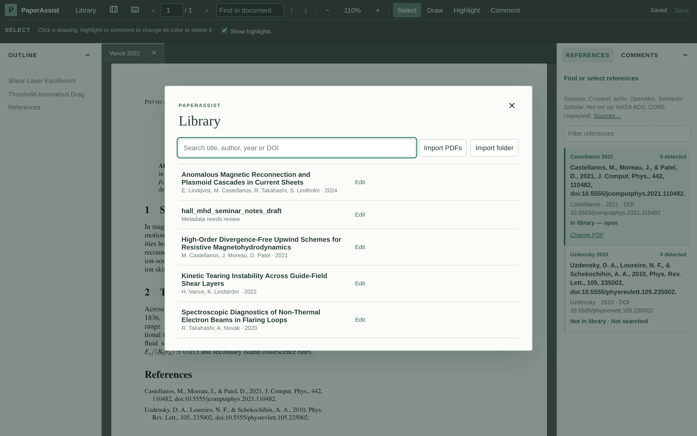
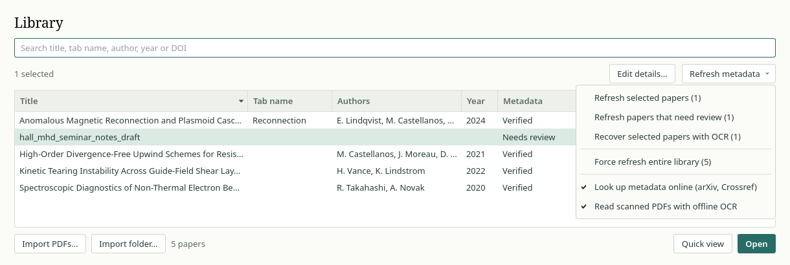

# PaperAssist

Reading a research paper is rarely linear. Half the time you are scrolling to the back to check who *Vance & Lindström (2022)* is, hunting through a `Downloads` folder full of cryptic publisher filenames to see if you already have that PDF, and losing your place in the paragraph you were actually trying to understand.

**PaperAssist** is a calm, local reading desk and shared library for scientific PDFs. It runs as a self-contained native desktop application built with Qt Widgets and PDFium, with no PaperAssist account, cloud sync, background web server, telemetry, or large language models. Reading and local import work offline; optional online reference actions use external services only when requested. A library can reuse the same PDF across multiple source papers; it is not a cloud collaboration service.

> **Project status:** Alpha (`0.2.0a2`). Reading, split reference consultation, highlighting, ink drawing, phrase-linked comments, and local library management are implemented and tested. Bibliography extraction and open-access retrieval remain partial. Start with a test library and keep backups; platform verification and distribution limits are listed below.

The screenshots below show the application on Linux with synthetic papers and a disposable library. System fonts and window appearance vary by platform.



---

## Installation & Quick Start

PaperAssist can be installed as a standalone desktop application (with Python, Qt, PDFium, and offline OCR bundled inside—no Python setup required) or run directly from a source checkout.

Download installers and their matching `.sha256` files from the [0.2.0a2 alpha release](https://github.com/gabrielesano/paperassist/releases/tag/v0.2.0a2). Platform provenance, third-party notices, and a combined checksum manifest (`SHA256SUMS`) are attached alongside the packages.

### Linux (`x86_64`) — Standalone Installer

For 64-bit Linux, PaperAssist provides a self-extracting per-user installer script (`PaperAssist-0.2.0a2-linux-x86_64.sh`) that requires **no `sudo` or root permissions**:

```bash
# 1. Verify package integrity (optional but recommended)
sha256sum -c PaperAssist-0.2.0a2-linux-x86_64.sh.sha256
sh ./PaperAssist-0.2.0a2-linux-x86_64.sh --verify

# 2. Install for your user account
sh ./PaperAssist-0.2.0a2-linux-x86_64.sh
```

- **Launch:** Open **PaperAssist** from your desktop application menu, or run `paperassist` from a terminal (`~/.local/bin/paperassist`). You can also pass PDF files directly (`paperassist paper.pdf`) to import a managed copy and open it, reusing identical PDFs already in the active library.
- **What gets installed where:** By default, application files live in `~/.local/share/paperassist-app`, the launcher in `~/.local/bin/paperassist`, and the desktop entry and icons under `~/.local/share/applications` and `~/.local/share/icons`. The installer respects XDG data directories. Your research library (`~/.local/share/paperassist`) and preferences (`~/.config/paperassist/config.json`) are kept separate and are not changed by the installer.
- **Upgrade:** Close PaperAssist and run the newer installer script (`sh ./PaperAssist-<new-version>-linux-x86_64.sh`). Upgrades verify a staged bundle before swapping application directories. Detected failures roll back; a process interruption may require `--repair`.
- **Repair:** After an interrupted upgrade, run `sh ./PaperAssist-0.2.0a2-linux-x86_64.sh --repair` to recover the previous committed installation. After an interrupted first install, repair clears incomplete owned state; rerun the installer to install the app.
- **Uninstall:** Run `~/.local/share/paperassist-app/uninstall.sh` (or `sh ./PaperAssist-0.2.0a2-linux-x86_64.sh --uninstall`). Only application-owned files are removed; your library, PDFs, annotations, and settings remain untouched.
- **System requirements:** Linux `x86_64`, `glibc >= 2.35`, `flock` (`util-linux`), X11 or Wayland, and Qt's system OpenGL/EGL and display libraries. The published installer was built on Ubuntu 22.04 and passed its ELF compatibility gate and install/self-test/uninstall checks. A clean Ubuntu/Debian desktop trial remains outstanding; see [packaging details](packaging/README.md).

### Windows (`x86_64`)

Download `PaperAssist-0.2.0a2-windows-x86_64-setup.exe` from the release and run the setup wizard. It installs for the current user in `%LOCALAPPDATA%\Programs\PaperAssist`, without administrator privileges, and creates a Start menu shortcut; a desktop shortcut is optional. Launch the installed app without a console window. The optional **Add PaperAssist to Open with for PDF files** task registers PDF support for your account and preserves your current default reader.

Close PaperAssist before upgrading or uninstalling. Run the newer setup EXE to update, or remove PaperAssist through Windows Settings. The library and preferences remain separate from the application and are preserved. The alpha installer is not Authenticode-signed, so Windows may show an unknown-publisher or SmartScreen prompt. Windows CI tests installation, the native window, the render worker, upgrade, and uninstall; see [Windows packaging](packaging/windows/README.md).

### macOS (Apple Silicon)

Download `PaperAssist-0.2.0a2-macos-arm64.dmg` from the release. This package supports Apple Silicon only:

1. Open the `.dmg` disk image and drag **PaperAssist.app** into **Applications**.
2. Eject the disk image and launch **PaperAssist** from Applications (no Python or Terminal required).
3. Use Finder’s **Open With → PaperAssist** for PDFs. To change the default reader, choose it yourself in **Get Info → Open with**.

*Note on macOS Gatekeeper:* Alpha builds are ad-hoc signed but are not Developer ID signed or notarized. Gatekeeper may block a downloaded app; creating a DMG does not establish publisher trust. To update, quit PaperAssist and replace `PaperAssist.app` in Applications; moving the app to Trash leaves your library and preferences intact. CI verifies the copied app, signature, rendering, and native Cocoa window on its Apple Silicon runner; older macOS versions are not verified. See [macOS packaging](packaging/macos/README.md).

### Run from a Source Checkout (Linux, macOS, Windows)

If you prefer running from source with **Python 3.11+**:

```bash
git clone https://github.com/gabrielesano/paperassist
cd paperassist
python -m venv .venv
.venv/bin/python -m pip install -e '.'
.venv/bin/python -m paperassist
```

On Windows PowerShell, replace `.venv/bin/python` in both commands with `.venv\Scripts\python.exe`.

### Command-line usage

Both the standalone application and the source console command open the reader. From source, `python -m paperassist` uses the same entry point. Command-line import is available in source installations:

| Command | What it does |
| --- | --- |
| `paperassist [FILE.pdf ...] [--data-dir DIR]`<br>`.venv/bin/python -m paperassist [FILE.pdf ...] [--data-dir DIR]` *(from source)* | Open the library, or import/reuse the given PDFs in tabs; send files to the existing window for that library |
| `paperassist --self-test FILE.pdf`<br>`.venv/bin/python -m paperassist --self-test FILE.pdf` *(from source)* | Headlessly render page 1 of `FILE.pdf` via the frozen/native render worker to verify the runtime (exits `0` on success) |
| `paperassist --self-test-ocr SCAN.pdf` *(new builds)*<br>`.venv/bin/python -m paperassist --self-test-ocr SCAN.pdf` *(from source, after building OCR)* | Verify the included OCR runtime on a scanned PDF without creating a library or changing the PDF |
| `paperassist import PATH... [--data-dir DIR]` *(source CLI)* | Import PDF files or folders recursively into the library from the terminal |

Only one instance accesses a library at a time (protected by a lock file inside the library folder). While the app is open, import new papers from the **Library** window (`L`) rather than running CLI imports against the same library in parallel.

**Managed PDF opening:** PDF arguments, **Open** (`Ctrl+O`), Quick view and operating-system file events import copies into the active library. Identical content reuses the same paper and its latest saved revision. **Save** writes a library revision and leaves the external original unchanged. A second launch selects the existing window for that library and preserves unsaved annotations and comment drafts; `--data-dir` selects a different library. Files managed by another library must be opened through that library. Linux and macOS offer PaperAssist in **Open with**; Windows setup offers an optional registration. Select a default reader through your system settings if desired. See [desktop integration](docs/development/desktop-plan.md).

---

## What reading in PaperAssist feels like

### Follow citations without losing your place

For imported papers, PaperAssist extracts the bibliography locally and ranks references in the right-hand **References** panel by detected citation frequency in the current paper. Extraction and counts may be incomplete. Internal PDF links and text detections are reconciled to reduce missed and duplicate citations, including recognized appendices and citations split between pages. Existing analyses refresh in the background while preserving manual reference links and acquisition selections.

- **Follow a citation:** The first click on a recognized in-text citation opens its available local PDF in Quick view; if it is missing, the click reveals its reference card without jumping to the bibliography. The second and later clicks on that reference reveal its card in the right column, even if its PDF is already open, without navigating or reopening the cited paper. This history is separate for each source paper and reference within the window session. Grouped or ambiguous citations offer a choice.
- **Stacked or side-by-side split view:** Expand a reference card and click its title or local-PDF action to open Quick view below the main paper. Toggle **Side by side** to compare papers horizontally; narrow reader areas stack automatically. Drag the divider to resize either pane. **Open in tab** preserves page, zoom, and edits when creating a new tab; when returning to an existing view, it transfers the page and uses Fit width while preserving that view's unsaved edits.
- **Independent controls for both panes:** Quick view has its own page, find, and zoom controls. Toolbar navigation controls target the main paper; navigation shortcuts target the active pane.
- **Step through detected in-text mentions:** Expand a reference card, then click its citation count button to move between located mentions, wrapping after the last one. When exact text coordinates are unavailable, navigation falls back to the detected page.
- **Filter and nickname tabs:** Use **Filter references** (`/` key) to narrow long bibliographies by author, year, title, label, or DOI (ignoring case and accents; each tab remembers its own filter). Double-click any open tab—or focus it and press `F2`—to give it a short session nickname like *"Vance 2022"* without altering its bibliographic title or filename on disk.



### Find missing references—via open access or your own downloads

Opening an imported paper in a new main tab offers the **Acquire references** dialog: consult available local copies, explicitly search for selected missing papers, or choose **Continue reading**. Switching existing tabs and opening Quick view do not trigger another acquisition prompt.



- **Open-access lookup:** Tick entries in **Acquire references**—or click **Find open access** on a reference card—to check the enabled, configured bibliographic and open-access providers (Crossref, arXiv, OpenAlex, Semantic Scholar, Unpaywall, NASA ADS, and CORE). Results distinguish provider failures and missing copies; a timeout is not proof of a paywall.
- **Web search & library proxy links:** Unresolved references offer prefilled web and PDF searches, plus one-click links through your institution's **Library proxy** if you configure one.
- **Manual downloads without filename chaos:** Set **Folder for manual downloads** in **Preferences**. **Check folder** may identify the reference online, then checks PDFs in that folder and copies a verified match into the library without changing the downloaded file. Uncertain candidates require review. Identified papers can receive names such as `Author_Year_Journal_Volume_Page.pdf`; **Change PDF** lets you correct a link.

### Highlight, draw, and attach notes to exact phrases

Annotation controls live in a calm contextual strip inside the top toolbar—never as floating popovers that cover the sentence or equation you are trying to read.



- **Clean PDF annotations:** Use **Highlight** (`H`) for text-aligned bands, **Draw** (`D`) for freehand ink, and **Select** (`V`) to select, recolor, or delete supported marks. Ink and freehand highlights can also move and resize proportionally using corner handles; text-aligned highlights keep their text geometry. On pages without a text layer, Highlight draws a freehand stroke.
- **Phrase-linked comments:** Select a passage and click **Comment** (or press `C`) to attach a note directly to those words. Saved phrase comments leave a subtle red dashed outline on the page even when the sidebars are hidden; clicking the outlined text jumps straight to its note in the **Comments** panel, and clicking a note brings you back to that exact phrase. Creating a comment without selecting text attaches a general note to the current page.
- **Explicit saving—never behind your back:** PDF annotations are written **only when you click Save** (or press `Ctrl+S` / `Cmd+S`). PaperAssist never autosaves on timers, tab switches, or previews. Switching tabs keeps unsaved edits in memory, and closing a modified tab or quitting the app always asks whether to **Save**, **Discard**, or **Cancel**. Your imported original PDFs are never modified; annotated revisions are stored separately, and annotations stay tied to the exact PDF file you marked up.
- **Comments are separate from PDF annotations:** **Save comment** writes a note to the library catalog, without creating a PDF revision. Deleting or recoloring a saved comment updates the catalog immediately. Sidecar comments are not embedded in saved PDF revisions. Unsaved comment drafts remain in memory across tab switches and participate in close confirmation.

### Build a clean, private local library

Open **Library** (`L` key) to browse and search your collection by title, tab name, author, year, DOI, filename, or metadata status. The catalog displays five columns: **Title**, **Tab name** (showing persistent catalog nicknames that you can edit via **Edit details…** through the library catalog), **Authors**, **Year**, and **Metadata**. Click any column header to sort in either direction (unknown years sort last); select multiple papers using `Ctrl`-click or `Shift`-click; and open a paper in a main tab (**Open**) or below in **Quick view**. Add papers via **Import PDFs…** or **Import folder…**—when importing a single PDF, choose **Import & open** to import the file and immediately view it in a reader tab. **Open** (`Ctrl+O` in the reader) imports/reuses a managed copy and opens it in a tab; its explicit Save creates a library revision.



- **Originals stay untouched:** Importing copies PDFs into PaperAssist's managed library and deduplicates them by file content (`SHA-256`). Re-importing a folder safely skips files you already have and preserves any manual metadata edits you have made.
- **Deterministic metadata—no LLMs:** Titles, authors, years, and candidate DOIs are read locally from PDF properties, XMP metadata, and bounded first-page typography (including multiline titles, author lines, and printed arXiv submission stamps). Because a DOI on page 1 can belong to a cited work, uncertain results are kept for review and marked **Needs review** (with per-field provenance tooltips). Select a paper and click **Edit details…** (`F2`) to confirm or fix its title, tab name, authors, year, or DOI. Only the specific fields you actually change are frozen as manual corrections, leaving untouched fields eligible for future enrichment (for legacy entries edited before this granular protection, previously corrected fields that differ from extracted or verified values remain protected).
- **Background metadata refresh & OCR:** Use **Refresh metadata** to recheck selected papers, all papers flagged **Needs review**, or the entire library in a cancellable background job that continues even if you close the Library window. Its dropdown menu provides:
  - **Read scanned PDFs with offline OCR (checked by default):** Runs local PDF extraction and invokes **offline OCR** only if native text at the top of the first page (before the abstract) is absent or shorter than 150 characters, and metadata remains incomplete.
  - **Recover selected papers with OCR:** Forces OCR on all selected papers, including scans that already possess an incomplete or low-quality text layer.
  - **Online corroboration:** When **Look up metadata online (arXiv, Crossref)** is enabled, DOIs, arXiv IDs, publication references, and titles/authors recovered by OCR or local heuristics are sent to external providers to verify and corroborate records. Uncheck this toggle to run completely offline without network requests.
  - New standalone builds include the offline OCR engine and English model; see [Offline OCR](#offline-ocr).



---

## Keyboard shortcuts

Press `?` while the reader has focus, or choose **Keyboard shortcuts** from the **PaperAssist** menu at the top left. That menu also provides **Preferences** (`Ctrl+,`), **Sources**, and **About**. On macOS, use `Cmd` in place of `Ctrl`. Single-letter shortcuts pause while typing in a text field or using a modal dialog.

| Keys | Action |
| --- | --- |
| `N` / `J`, `P` / `K` | Next page, previous page |
| `Home`, `End`, `G` | First page, last page, or jump to a specific page number |
| `Alt+Left` | Return to previous reading position after jumping |
| `Esc` | Close an open dialog, or return focus from a toolbar field back to the PDF so arrows, `Space`, and `Page Up`/`Down` scroll naturally |
| `Ctrl+F` | Find text in the paper pane you clicked last |
| `Ctrl++`, `Ctrl+-`, `Ctrl+0` | Zoom in, zoom out, or fit page width |
| `V`, `D`, `H`, `C` | Switch to **Select**, **Draw**, **Highlight**, or **Comment** |
| `Delete` / `Backspace` | Delete the currently selected highlight or ink drawing |
| `Ctrl+Z`, `Ctrl+Shift+Z` (`Ctrl+Y`) | Undo or redo annotation changes |
| `Ctrl+S` | Save PDF annotations |
| `L` (`Ctrl+L`), `Ctrl+O` | Open **Library** catalog, or import/reuse and open a PDF from disk |
| `Ctrl+,` | Open **Preferences** |
| `,` and `.`, `X` (`Ctrl+W`), `F2` | Switch tabs, close the current tab, or rename the focused tab (`F2` also opens **Edit details…** in **Library**) |
| `B` (`Ctrl+B`), `Ctrl+E` | Hide or restore both side panels; toggle **Quick view** |
| `O`, `1`, `2` | Toggle **Outline**, or show **References** or **Comments** |
| `/` | Focus **Filter references** (`Esc` clears the filter; a second `Esc` returns to the paper) |

When **Quick view** is open, page navigation, `G`, `Ctrl+F`, and zoom shortcuts act on whichever paper pane you clicked last.

### Interface size

**Preferences → Interface size** scales the toolbar, tabs, side panels, dialogs, and menus from `80%` to `150%` and saves your preference in your user configuration across sessions. Papers keep their own independent zoom controls.

---

## Where your library lives & backups

The library folder contains managed PDFs, saved annotated revisions, comments, source settings, and the SQLite catalog (`library.sqlite3`). **Preferences → Library location** shows its path. Your selected library location and interface preferences are stored separately in the user config file.

| Operating system | Default library folder | User config file |
| --- | --- | --- |
| Linux | `$XDG_DATA_HOME/paperassist` (or `~/.local/share/paperassist`) | `$XDG_CONFIG_HOME/paperassist/config.json` (or `~/.config/paperassist/config.json`) |
| macOS | `~/Library/Application Support/PaperAssist` | `~/Library/Preferences/PaperAssist/config.json` |
| Windows | `%APPDATA%\PaperAssist` | `%LOCALAPPDATA%\PaperAssist\config.json` |

Inside the library folder:
- **`originals/`** holds unmodified imported PDFs, using a bibliographic filename when enough metadata is available, or the imported filename otherwise (with a suffix for collisions). Read these files freely, but do not manually edit, rename, or move them: the catalog tracks their exact content and path.
- **`working/`** holds saved annotated revisions under internal IDs.

### Moving or switching libraries

Open **Preferences**, pick a folder under **Library location**, click **Use this folder**, and confirm **Open library** or **Move library**:

- **Existing PaperAssist library:** PaperAssist switches to it and leaves your previous library untouched.
- **Empty or new folder:** PaperAssist copies your entire current library there, verifies every file, and switches over. Your old folder is left intact until you choose to delete it yourself.
- **Non-empty unrelated folder:** Refused, so PaperAssist never mixes its files with unrelated documents.

If your configured library folder is unavailable at startup—for instance, on an unplugged external drive—PaperAssist stops with a clear message instead of silently creating a blank library. Passing `--data-dir` overrides `PAPERASSIST_DATA_DIR`, which in turn overrides the folder chosen in **Preferences**.

### Backing up

Close PaperAssist and copy the library directory. Back up the separate user config too if you want to preserve interface preferences and the selected library path. Keep backups private: `settings.json` contains configured contact details and API keys in plaintext. The writer requests `0600` permissions on POSIX systems; Windows access depends on filesystem permissions.

---

## Open-access sources & institutional access

Open **Sources** to toggle lookup providers and add optional API keys or contact details. API keys are stored locally in `settings.json`; the UI does not redisplay full saved keys. Contact email and proxy settings remain visible. **Check access** explicitly contacts the enabled, configured services.

| Service | Optional / required setting | What it enables |
| --- | --- | --- |
| **Crossref** | Contact email *(optional)* | Identifies DOIs and bibliographic records; an email uses Crossref's polite rate-limit pool |
| **arXiv** | None | Official preprint metadata and open-access PDFs |
| **OpenAlex** | API key *(recommended; optional in the app)* | Open-access discovery; a key increases the service's usage budget |
| **Semantic Scholar** | API key *(optional)* | Metadata and open-access links with higher rate limits when a key is set |
| **Unpaywall** | Contact email *(required)* | Finds legal open-access copies for papers with a DOI |
| **NASA ADS** | API token *(required)* | Astrophysics & physics bibliography identification and lookups |
| **CORE** | API key *(required)* | Repository full-text discovery |

If the corresponding field in **Sources** is left blank, PaperAssist also checks the `PAPERASSIST_EMAIL` and `OPENALEX_API_KEY` environment variables.

Source availability, authentication rules, and quotas are controlled by each provider; configuring a source does not guarantee a download. See [OpenAlex authentication](https://help.openalex.org/api/authentication/) for its current anonymous-access and key limits. Crossref supplies bibliographic metadata and links, rather than hosting the PDF itself.

- **Library proxy:** Optional `https://...` prefix (or template containing `{url}`) for your university's proxy. PaperAssist uses it strictly to build links that *you* click in your browser—it never runs automated downloads through your institutional session.
- **Folder for manual downloads (in Preferences):** A folder you select with the native dialog. PaperAssist reads it when you choose **Check folder**; it does not continuously monitor or change its contents.

---

## Privacy & current limitations

- **Local reading:** The native reader accesses PDFs and the catalog without a web server or listening network port. Requested online actions include open-access searches, **Refresh metadata** (when online lookup is enabled), source access checks, download repair, and reference identification during **Check folder**. They send reference or paper metadata and identifiers, plus any relevant configured credentials, to providers; external links open in your browser.
- **Separate rendering process:** PDFium renders whole-page bitmaps in a worker process with a bounded page cache; it does not use tile rendering. Memory and latency vary with documents, zoom, open panes, and platform. See the scoped measurements in [native stack notes](docs/development/native-stack.md), rather than treating them as a fixed memory guarantee or a security sandbox.
- **No AI guesswork:** Importing, metadata extraction, and citation matching are 100% deterministic.
- **Citation detection is partial:** PaperAssist recognizes author-year and bracketed numeric citations, abstaining when entries cannot be disambiguated. A six-paper tuning benchmark reported about 96% recall at the reference/page level, not exact sentence-level accuracy or a guarantee on new papers. The private benchmark is not reproducible from this repository; see [accuracy notes](docs/development/citation-accuracy.md). OCR errors, superscripts, and unusual styles can cause missed citations.
- **Scans & large files:** Image-only pages can be read and marked with ink or freehand highlighting. Text search, text-aligned highlighting, phrase comments, and bibliography extraction depend on an existing text layer (PaperAssist does not write an OCR text layer into PDFs). For scanned papers lacking extractable text, **Refresh metadata** can optionally invoke a local **Tesseract** (`eng`) worker in an isolated background process to recover provisional titles and authors (reading page 1, and falling back to page 2 only if no title is recognized on page 1). Standalone builds include a minimal Tesseract engine and English model; it requires no separate Tesseract installation. A missing or damaged bundled runtime is reported without affecting normal metadata extraction.
- **Packaged OCR verification:** The bundled engine has been tested on Linux from a copied standalone app with an empty `PATH` and in an offline Fedora 43 container without system Tesseract or language data. Hosted builds have also passed OCR from the installed Linux launcher, Windows setup installation and macOS app copied from its DMG, plus the Ubuntu GLIBC_2.35 gate and platform installer/native-window checks. The full native Cocoa test suite also passes. Interactive desktop and hardware coverage remain follow-up work. See [host acceptance](docs/development/host-acceptance.md).

---

## Offline OCR

Standalone builds include a minimal **Tesseract 5.5.4** engine, Leptonica and the
English LSTM model. No separate OCR installation, model download or network
connection is needed. The engine runs in PaperAssist's isolated background OCR
worker and reads the grayscale pages rendered by PDFium. Only metadata recovery
uses OCR; it does not add a searchable text layer to the PDF.

For development from source, compile the bundled runtime once using CMake
and a C/C++ compiler:

```bash
.venv/bin/python packaging/ocr/build_ocr.py
```

The source app automatically uses the resulting `build/ocr/runtime` directory.
A source installation without that build can still use a system Tesseract 4.1+
with English data. Standalone builds always use their own engine and model.

---

## Development & Packaging

```bash
python -m venv .venv
.venv/bin/python -m pip install -e '.'

# Run the Python & native Qt test suite (headless offscreen mode supported)
QT_QPA_PLATFORM=offscreen .venv/bin/python -m unittest discover -s tests -v

# Run a headless native rendering self-test on a fixture PDF
.venv/bin/python -m paperassist --self-test tests/fixtures/pdfjs-annotations.pdf
```

To build the standalone application bundle and Linux installer locally:

```bash
.venv/bin/python -m pip install '.' 'pyinstaller>=6.15,<7'
.venv/bin/python packaging/ocr/build_ocr.py
.venv/bin/pyinstaller packaging/paperassist.spec --noconfirm --distpath dist --workpath build
.venv/bin/python packaging/installer/build_installer.py
```

For architecture, packaging, and verification details, see:

- [Product specification](docs/specification.md) & [Implementation roadmap](docs/roadmap.md)
- [Native stack measurements](docs/development/native-stack.md)
- [Offline OCR metadata recovery notes](docs/development/offline-ocr.md) & [Citation accuracy notes](docs/development/citation-accuracy.md)
- [Linux & bundle packaging guide](packaging/README.md), [Windows packaging guide](packaging/windows/README.md), and [macOS packaging guide](packaging/macos/README.md)

---

## License

PaperAssist is free software licensed under the **GNU General Public License v3.0 or later** (see [`LICENSE`](LICENSE)).

The reader uses [Qt / PySide6](https://wiki.qt.io/Qt_for_Python), [PDFium](https://pdfium.googlesource.com/pdfium/) through [pypdfium2](https://github.com/pypdfium2-team/pypdfium2), and [pypdf](https://github.com/py-pdf/pypdf). These components retain their own licenses; standalone builds include `THIRD-PARTY-NOTICES.txt` and bundled dependency license files.

Bundled releases also include Tesseract and the English `tessdata_fast`
model under Apache-2.0, and Leptonica under BSD-2-Clause. Their full license texts
and pinned source URLs are included in the bundle's third-party notices.
